# Class Diagram: Smart Campus Lost and Found

This document illustrates the Object-Oriented design, class hierarchies, models, Data Access Objects (DAOs), utilities, and graphical user interface components of the **Smart Campus Lost and Found System**.

---

## 1. Mermaid Class Diagram

```mermaid
classDiagram
    %% Model Classes
    class User {
        -int userId
        -String name
        -String email
        -String password
        -Role role
        -Timestamp createdAt
        +getUserId() int
        +setUserId(int) void
        +getName() String
        +getEmail() String
        +getPassword() String
        +getRole() Role
        +isAdmin() boolean
    }

    class Role {
        <<enumeration>>
        STUDENT
        ADMIN
        +fromString(String) Role
    }

    class Item {
        -int itemId
        -String title
        -String description
        -String category
        -String location
        -ItemType itemType
        -ItemStatus status
        -int reportedBy
        -Timestamp reportDate
        -String reporterName
        +getItemId() int
        +getTitle() String
        +getItemType() ItemType
        +getStatus() ItemStatus
        +getReportedBy() int
    }

    class ItemType {
        <<enumeration>>
        LOST
        FOUND
        +fromString(String) ItemType
    }

    class ItemStatus {
        <<enumeration>>
        OPEN
        CLAIMED
        RETURNED
        +fromString(String) ItemStatus
    }

    class Claim {
        -int claimId
        -int itemId
        -int claimedBy
        -String message
        -ClaimStatus status
        -Timestamp claimDate
        -String itemTitle
        -String claimantName
        -String claimantEmail
        +getClaimId() int
        +getItemId() int
        +getClaimedBy() int
        +getStatus() ClaimStatus
        +getMessage() String
    }

    class ClaimStatus {
        <<enumeration>>
        PENDING
        APPROVED
        REJECTED
        +fromString(String) ClaimStatus
    }

    User --> Role
    Item --> ItemType
    Item --> ItemStatus
    Claim --> ClaimStatus

    %% Database Configuration
    class DBConnection {
        -String url$
        -String user$
        -String password$
        +getConnection()$ Connection
        +closeConnection(Connection)$ void
        -loadConfiguration()$ void
    }

    %% Data Access Objects (DAOs)
    class UserDAO {
        +register(User) boolean
        +findByEmail(String) User
        +findById(int) User
        +emailExists(String) boolean
        +getAllUsers() List~User~
        +updateUserRole(int, Role) boolean
        +deleteUser(int) boolean
        +countAdminUsers() int
        +hasUserRelatedRecords(int) boolean
        +getTotalUsersCount() int
    }

    class ItemDAO {
        +addItem(Item) boolean
        +findById(int) Item
        +getAllItems() List~Item~
        +searchItems(String, String, String, String) List~Item~
        +getItemsByReporter(int) List~Item~
        +updateStatus(int, ItemStatus) boolean
        +deleteItem(int) boolean
        +deleteItemWithClaims(int) boolean
        +getItemClaimsCount(int) int
        +getLostItemsCount() int
        +getFoundItemsCount() int
        +getOpenItemsCount() int
    }

    class ClaimDAO {
        +submitClaim(Claim) boolean
        +hasUserClaimed(int, int) boolean
        +findById(int) Claim
        +getAllClaims() List~Claim~
        +getClaimsByUser(int) List~Claim~
        +updateClaimStatus(int, ClaimStatus) boolean
        +hasApprovedClaimForItem(int) boolean
        +approveClaimTransaction(int, int) boolean
        +rejectClaim(int) boolean
        +getPendingClaimsCount() int
    }

    UserDAO ..> DBConnection : uses
    ItemDAO ..> DBConnection : uses
    ClaimDAO ..> DBConnection : uses
    UserDAO ..> User : manages
    ItemDAO ..> Item : manages
    ClaimDAO ..> Claim : manages

    %% Utilities
    class PasswordUtil {
        -String ALGORITHM$
        -int ITERATIONS$
        -int KEY_LENGTH$
        -int SALT_LENGTH$
        +hashPassword(String)$ String
        +verifyPassword(String, String)$ boolean
    }

    class ValidationUtil {
        +validateRegistration(String, String, String, String)$ ValidationResult
        +validateLogin(String, String)$ ValidationResult
        +isValidEmail(String)$ boolean
    }

    class SessionManager {
        -SessionManager instance$
        -User currentUser
        +getInstance()$ SessionManager
        +login(User) void
        +logout() void
        +isLoggedIn() boolean
        +isAdmin() boolean
        +getUserId() int
        +getUserName() String
    }

    %% UI Controllers & Dashboards
    class LoginFrame {
        -UserDAO userDAO
        -JTextField emailField
        -JPasswordField passwordField
        -handleLogin() void
        -openRegisterFrame() void
    }

    class RegisterFrame {
        -UserDAO userDAO
        -JTextField nameField
        -JTextField emailField
        -JPasswordField passwordField
        -handleRegistration() void
        -openLoginFrame() void
    }

    class StudentDashboard {
        -ItemBrowsePanel browsePanel
        -MyReportedItemsPanel reportedItemsPanel
        -MyClaimsPanel claimsPanel
        -openReportDialog() void
        -handleLogout() void
    }

    class AdminDashboard {
        -UserDAO userDAO
        -ItemDAO itemDAO
        -ClaimDAO claimDAO
        -ManageUsersPanel usersPanel
        -ManageItemsPanel itemsPanel
        -ManageClaimsPanel claimsPanel
        +refreshStatisticsAsync() void
        -handleLogout() void
    }

    LoginFrame ..> UserDAO : authenticates via
    LoginFrame ..> PasswordUtil : verifies hash via
    LoginFrame ..> SessionManager : creates session in
    RegisterFrame ..> UserDAO : registers with
    RegisterFrame ..> PasswordUtil : hashes with
    StudentDashboard ..> SessionManager : checks session
    AdminDashboard ..> SessionManager : enforces admin
```

---

## 2. Design Pattern Implementation Details

1. **Model-View-DAO (Layered Architecture)**:
   - **Models (`models/`)**: Encapsulate tabular entity data as pure domain objects without direct SQL coupling.
   - **Data Access Objects (`dao/`)**: Contain all database operations and SQL `PreparedStatement` definitions, isolating query logic from GUI components.
   - **Views (`ui/`)**: Swing windows, dialogs, and custom rendered panels providing an interactive experience.
2. **Singleton Pattern**:
   - `SessionManager`: Employs double-checked locking and a `volatile` reference to maintain one consistent, thread-safe user session throughout application execution.
3. **Factory & Theme Architecture**:
   - `UITheme`: Centralized factory producing pre-styled cards, padded text fields, rounded borders, and colors, standardizing the application look-and-feel.
4. **Asynchronous Worker Pattern**:
   - `SwingWorker<T, V>`: Subclassed across all UI actions to execute database queries on a pooled background thread (`doInBackground()`) and publish updates on the Swing Event Dispatch Thread (`done()`).
