# Class Diagram: Smart Campus Lost and Found

This document illustrates the Object-Oriented design, class hierarchies, models, Data Access Objects (DAOs), utilities, and graphical user interface components of the **Smart Campus Lost and Found System**.

> **Implementation Note:**  
> All classes documented below are fully developed and compiled into `bin/`. Feature 7 notifications are fully integrated in Java code; the underlying MySQL table migration (`sql/migration_feature7_notifications.sql`) is prepared for review and is pending execution. Runtime testing has not yet been executed.

---

## 1. Mermaid Class Diagram

```mermaid
classDiagram
    %% Model Classes
    class User {
        -int userId
        -String name
        -String email
        -String password
        -Role role
        -Timestamp createdAt
        +getUserId() int
        +getName() String
        +getEmail() String
        +getRole() Role
        +isAdmin() boolean
    }

    class Role {
        <<enumeration>>
        STUDENT
        ADMIN
        +fromString(String) Role
    }

    class Item {
        -int itemId
        -String title
        -String description
        -String category
        -String location
        -String imagePath
        -String building
        -String floorRoom
        -ItemType itemType
        -ItemStatus status
        -int reportedBy
        -Timestamp reportDate
        -String reporterName
        +getItemId() int
        +getTitle() String
        +getImagePath() String
        +getBuilding() String
        +getFloorRoom() String
        +getItemType() ItemType
        +getStatus() ItemStatus
        +getReportedBy() int
    }

    class ItemType {
        <<enumeration>>
        LOST
        FOUND
        +fromString(String) ItemType
    }

    class ItemStatus {
        <<enumeration>>
        OPEN
        CLAIMED
        RETURNED
        +fromString(String) ItemStatus
    }

    class Claim {
        -int claimId
        -int itemId
        -int claimedBy
        -String message
        -ClaimStatus status
        -Timestamp claimDate
        -String itemTitle
        -String claimantName
        -String claimantEmail
        +getClaimId() int
        +getItemId() int
        +getClaimedBy() int
        +getStatus() ClaimStatus
        +getMessage() String
    }

    class ClaimStatus {
        <<enumeration>>
        PENDING
        APPROVED
        REJECTED
        +fromString(String) ClaimStatus
    }

    class Notification {
        -int notificationId
        -int userId
        -String title
        -String message
        -NotificationType notificationType
        -String referenceType
        -Integer referenceId
        -String dedupKey
        -boolean isRead
        -Timestamp createdAt
        +getNotificationId() int
        +getUserId() int
        +getTitle() String
        +getMessage() String
        +getDedupKey() String
        +isRead() boolean
    }

    class NotificationType {
        <<enumeration>>
        CLAIM_SUBMITTED
        CLAIM_APPROVED
        CLAIM_REJECTED
        ITEM_RETURNED
        ITEM_STATUS_CHANGED
        GENERAL
        +fromString(String) NotificationType
    }

    class MatchResult {
        -Item targetItem
        -Item candidateItem
        -int matchScore
        -int categoryScore
        -int locationScore
        -int textScore
        -String explanation
        +getMatchScore() int
        +getExplanation() String
    }

    User --> Role
    Item --> ItemType
    Item --> ItemStatus
    Claim --> ClaimStatus
    Notification --> NotificationType

    %% Database Configuration
    class DBConnection {
        -String url$
        -String user$
        -String password$
        +getConnection()$ Connection
        +closeConnection(Connection)$ void
        -loadConfiguration()$ void
    }

    %% Data Access Objects (DAOs)
    class UserDAO {
        +register(User) boolean
        +findByEmail(String) User
        +findById(int) User
        +emailExists(String) boolean
        +getAllUsers() List~User~
        +updateUserRole(int, Role) boolean
        +deleteUser(int) boolean
        +countAdminUsers() int
        +getTotalUsersCount() int
    }

    class ItemDAO {
        +addItem(Item) boolean
        +findById(int) Item
        +getAllItems() List~Item~
        +searchItems(String, String, String, String) List~Item~
        +searchItems(String, String, String, String, String) List~Item~
        +getItemsByReporter(int) List~Item~
        +getEligibleCandidateItems(ItemType, int, int) List~Item~
        +updateStatus(int, ItemStatus) boolean
        +deleteItem(int) boolean
        +deleteItemWithClaims(int) boolean
    }

    class ClaimDAO {
        +submitClaim(Claim) boolean
        +hasUserClaimed(int, int) boolean
        +findById(int) Claim
        +getAllClaims() List~Claim~
        +getClaimsByUser(int) List~Claim~
        +updateClaimStatus(int, ClaimStatus) boolean
        +approveClaimTransaction(int, int) boolean
        +rejectClaim(int) boolean
    }

    class NotificationDAO {
        +insertInTransaction(Connection, Notification) boolean
        +createNotification(Notification) boolean
        +getNotificationsByUser(int, boolean) List~Notification~
        +getUnreadCount(int) int
        +markAsRead(int, int) boolean
        +markAllAsRead(int) boolean
        +isTableAvailable(Connection)$ boolean
    }

    UserDAO ..> DBConnection : uses
    ItemDAO ..> DBConnection : uses
    ClaimDAO ..> DBConnection : uses
    NotificationDAO ..> DBConnection : uses
    UserDAO ..> User : manages
    ItemDAO ..> Item : manages
    ClaimDAO ..> Claim : manages
    NotificationDAO ..> Notification : manages
    ClaimDAO ..> NotificationDAO : creates notifications in tx
    ItemDAO ..> NotificationDAO : creates status notifications

    %% Utilities & Engine
    class PasswordUtil {
        +hashPassword(String)$ String
        +verifyPassword(String, String)$ boolean
    }

    class ValidationUtil {
        +validateRegistration(String, String, String, String)$ ValidationResult
        +validateLogin(String, String)$ ValidationResult
        +isValidEmail(String)$ boolean
    }

    class SessionManager {
        -SessionManager instance$
        -User currentUser
        +getInstance()$ SessionManager
        +login(User) void
        +logout() void
        +isLoggedIn() boolean
        +isAdmin() boolean
        +getUserId() int
        +getUserName() String
    }

    class ItemMatchingEngine {
        +findMatches(Item, List~Item~)$ List~MatchResult~
        -calculateSimilarity(Item, Item)$ MatchResult
    }

    class ImageUtil {
        +saveItemPhoto(File)$ String
        +scaleImage(File, int, int)$ BufferedImage
    }

    %% UI Components & Dashboards
    class LoginFrame {
        -UserDAO userDAO
        -JTextField emailField
        -JPasswordField passwordField
        -handleLogin() void
    }

    class RegisterFrame {
        -UserDAO userDAO
        -JTextField nameField
        -JTextField emailField
        -handleRegistration() void
    }

    class StudentDashboard {
        -StudentHomeOverviewPanel overviewPanel
        -ItemBrowsePanel browsePanel
        -MyReportedItemsPanel reportedItemsPanel
        -MyClaimsPanel claimsPanel
        -NotificationsPanel notificationsPanel
        -JButton topBellBtn
        -updateUnreadBadgeAsync() void
    }

    class AdminDashboard {
        -AdminHomeOverviewPanel overviewPanel
        -ManageItemsPanel itemsPanel
        -ManageClaimsPanel claimsPanel
        -ManageUsersPanel usersPanel
    }

    class NotificationsPanel {
        -NotificationDAO notificationDAO
        -loadNotificationsAsync() void
        -handleMarkSingleRead(int) void
        -handleMarkAllAsRead() void
    }

    class CampusIcons {
        +get(IconType)$ Icon
        +get(IconType, int, int, Color)$ Icon
    }

    class CampusLogo {
        -LogoSize size
    }

    StudentDashboard --> NotificationsPanel
    StudentDashboard ..> SessionManager : checks session
    AdminDashboard ..> SessionManager : enforces admin
    LoginFrame ..> UserDAO : authenticates via
    RegisterFrame ..> UserDAO : registers with
    MyReportedItemsPanel ..> ItemMatchingEngine : calculates matches via
```

---

## 2. Design Pattern Implementation Details

1. **Model-View-DAO (3-Tier Layered Architecture)**:
   - **Models (`models/`)**: Encapsulate tabular entity data as pure domain objects (`User`, `Item`, `Claim`, `Notification`, `MatchResult`).
   - **Data Access Objects (`dao/`)**: Contain all database operations and SQL `PreparedStatement` definitions, isolating query logic from GUI components.
   - **Views (`ui/`)**: Swing windows, dialogs, and custom-rendered panels providing an interactive experience.
2. **Singleton Pattern**:
   - `SessionManager`: Thread-safe singleton maintaining the authenticated session across the application lifecycle.
3. **Transaction & Unit of Work Pattern**:
   - `ClaimDAO.approveClaimTransaction`: Enforces atomic adjudication across claims, items, and in-transaction notifications with automatic rollback on collision.
4. **Asynchronous Worker Pattern**:
   - Subclassed `SwingWorker<T, V>` across all UI actions to execute database queries on background threads while dispatching GUI mutations on the Swing Event Dispatch Thread (EDT).
5. **Deterministic Matching Engine**:
   - `ItemMatchingEngine`: Pure algorithmic similarity engine using category taxonomy, spatial token matching, and Dice text coefficient without third-party cloud or external AI services.
