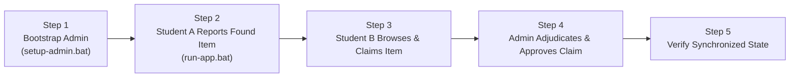

# Live Demonstration and Presentation Guide

**Project:** Smart Campus Lost and Found Management System  
**Audience:** College Evaluation Committee / External Examiner / Viva Voce  
**Target Duration:** 5 to 10 Minutes  

---

## 1. Pre-Demo Checklist (Complete 5 Minutes Before Presentation)

- [ ] **MySQL Service Running**: Verify MySQL 8.0 is active (`net start MySQL80` or via Windows Services).
- [ ] **Configuration Check**: Verify `config/db.properties` contains the correct database password.
- [ ] **Quick Diagnostic**: Run [`run-db-test.bat`](file:///e:/JAVA%20Project/SmartCampusLostAndFound/run-db-test.bat) to confirm database connectivity and table readiness.
- [ ] **Clean Terminal**: Open a Command Prompt or PowerShell in `E:\JAVA Project\SmartCampusLostAndFound`.

---

## 2. Step-by-Step 5–10 Minute Live Demo Script

---

### Step 1: Administrator Bootstrap (Time: 1 Minute)
*Goal: Demonstrate that public registration is student-only and admin credentials are securely set up.*

1. Double-click [`setup-admin.bat`](file:///e:/JAVA%20Project/SmartCampusLostAndFound/setup-admin.bat).
2. Enter the administrator credentials:
   - **Name**: `Campus Chief Proctor`
   - **Email**: `proctor@campus.edu`
   - **Password**: `Admin#Campus2026`
3. Notice the masked password entry and the confirmation:
   `[SUCCESS] Setup complete! You can now log into the Admin Dashboard.`
4. Explain to the examiner:
   > *"Public registration only allows student accounts. The administrator account is bootstrapped through this dedicated script, which hashes the password using PBKDF2 with a random salt before writing to the database."*

---

### Step 2: Student 1 Registers & Reports a FOUND Item (Time: 2 Minutes)
*Goal: Demonstrate student registration, UI styling, and item reporting.*

1. Double-click [`run-app.bat`](file:///e:/JAVA%20Project/SmartCampusLostAndFound/run-app.bat) to launch the login window.
2. Click **Register here** at the bottom:
   - **Full Name**: `Aarav Sharma`
   - **College Email**: `aarav@campus.edu`
   - **Password**: `StudentPass@123`
   - **Confirm Password**: `StudentPass@123`
3. Click **Create Account**. A confirmation dialog appears.
4. Sign in with `aarav@campus.edu` and `StudentPass@123`.
5. The **Student Dashboard** opens:
   - Point out the greeting: *"Welcome, Aarav Sharma (Student)"*.
6. Click **+ Report New Item**:
   - **Report Type**: `FOUND`
   - **Item Name / Title**: `Scientific Calculator (Casio)`
   - **Category**: `Electronics & Gadgets`
   - **Campus Location**: `Central Library 2nd Floor (Table 12)`
   - **Description**: `Black Casio FX-991EX calculator left near the charging port.`
7. Click **Submit Report**.
8. Switch to **My Reported Items** tab to show that the report is logged with status `OPEN`.
9. Click **Logout** at the top right.

---

### Step 3: Student 2 Browses and Submits a Claim (Time: 2 Minutes)
*Goal: Demonstrate dynamic searching, filters, and claim safeguards.*

1. Click **Register here** to create a second student account:
   - **Full Name**: `Priya Patel`
   - **College Email**: `priya@campus.edu`
   - **Password**: `PriyaPass@123`
   - **Confirm Password**: `PriyaPass@123`
2. Sign in as `priya@campus.edu`.
3. In the **Browse Campus Items** tab:
   - Type `"Calculator"` in the search bar and click **Filter**.
   - Show how the table dynamically filters matching items.
4. Select the row for the Casio Calculator:
   - Highlight that the **Claim Found Item** button becomes active.
   - Explain to the examiner: *"If Student 1 (Aarav) tried to claim this, the system would block it because students cannot claim items they reported themselves."*
5. Click **Claim Found Item**:
   - Enter ownership proof:
     `"My name 'Priya P.' is written in black permanent marker inside the slide-on battery cover."`
6. Click **Submit Claim**.
7. Switch to **My Submitted Claims** tab:
   - Show the new claim listed with amber status **PENDING**.
8. Click **Logout**.

---

### Step 4: Admin Review & Atomic Claim Approval (Time: 2 Minutes)
*Goal: Demonstrate administrative metrics, proof inspection, and atomic transaction status sync.*

1. Sign in with the administrator account (`proctor@campus.edu` / `Admin#Campus2026`).
2. The **Admin Dashboard** opens:
   - Point out the **Live KPI Summary Cards**:
     - *Total Users*: 2+
     - *Found Items*: 1
     - *Pending Claims*: 1
3. Switch to the **Manage Claims** tab:
   - Select the pending claim by Priya Patel.
   - Click **View Proof Details**:
     Show the examiner the modal displaying the claimant's exact ownership proof message.
   - Click **Approve Claim**.
   - Review the confirmation prompt explaining the atomic synchronization. Click **Yes**.
4. Show the updated claim status: turns green (**APPROVED**).
5. Switch to the **Manage Items** tab:
   - Show that the calculator's status has automatically synchronized from `OPEN` to amber (**CLAIMED**).
6. Explain to the examiner:
   > *"This approval executed as a single atomic database transaction. If there were competing claims, they would be automatically marked as REJECTED, and the item cannot be claimed again."*
7. Click **Logout**.

---

### Step 5: Verification in Student Portal (Time: 1 Minute)
*Goal: Close the loop and confirm student sees approved status.*

1. Sign back in as `priya@campus.edu` / `PriyaPass@123`.
2. Go to **My Submitted Claims**:
   - Point out that the claim status is now green (**APPROVED**).
   - Click **View Claim Details**: show the collection instructions directing the student to the Campus Lost & Found Security Office.

---

## 3. Recommended Screenshots for Project Submission Binder

Capture the following 8 screenshots during the walkthrough:

1. **`01_login_frame.png`**: The modern centered login card with FlatLaf styling and show/hide password toggle.
2. **`02_registration_frame.png`**: The registration screen showing validation and student role enforcement.
3. **`03_student_browse_panel.png`**: Student Dashboard showing the item table with search filter bar and color-coded status badges.
4. **`04_report_item_dialog.png`**: The modal dialog for submitting a lost or found item.
5. **`05_submit_claim_dialog.png`**: The claim form showing the selected item summary and ownership proof text area.
6. **`06_my_claims_panel.png`**: The student's personal claims tab displaying the pending and approved status badges.
7. **`07_admin_dashboard_kpis.png`**: The Administrator Dashboard showcasing the 5 colored KPI metric cards.
8. **`08_admin_manage_claims.png`**: The admin claim moderation panel displaying the claimant proof dialog.

---

## 4. Common Viva Voce Questions & Answers

**Q1: Why did you use `SwingWorker` instead of doing database calls directly in button listeners?**  
*Answer:* In Java Swing, all UI events and rendering run on a single thread called the Event Dispatch Thread (EDT). If a database query or network connection takes even 1 second, running it directly on the EDT causes the entire window to freeze, become unresponsive, and trigger "Not Responding" warnings in Windows. `SwingWorker` executes the query on a background thread pool and posts results back to the EDT cleanly in `done()`.

**Q2: What is the difference between SHA-256 and PBKDF2 for password hashing?**  
*Answer:* Plain SHA-256 is designed to be fast, which makes it vulnerable to brute-force and GPU dictionary attacks (billions of hashes per second). PBKDF2 applies 65,536 iterations of HMAC-SHA256 with a unique 128-bit random salt per user. This makes brute-force attacks computationally expensive and renders pre-computed rainbow table attacks ineffective.

**Q3: How do you prevent SQL injection in dynamic searches where users filter by keyword, category, and status?**  
*Answer:* Even when dynamic SQL strings are constructed with `StringBuilder`, we never concatenate user inputs directly into the SQL string. We append `?` parameter placeholders and bind user inputs strictly through `PreparedStatement.setObject()` or `setString()`, ensuring the database engine treats all user inputs strictly as literals.

**Q4: How does the system handle concurrent conflicting claims on the same found item?**  
*Answer:* The approval operation in `ClaimDAO.approveClaimTransaction()` runs inside a database transaction with `conn.setAutoCommit(false)`. It first checks whether an approved claim already exists for the item. When the admin approves a claim, it updates the selected claim to `APPROVED`, changes the item status to `CLAIMED`, and sets all other pending claims on that item to `REJECTED`, committing the changes atomically.
