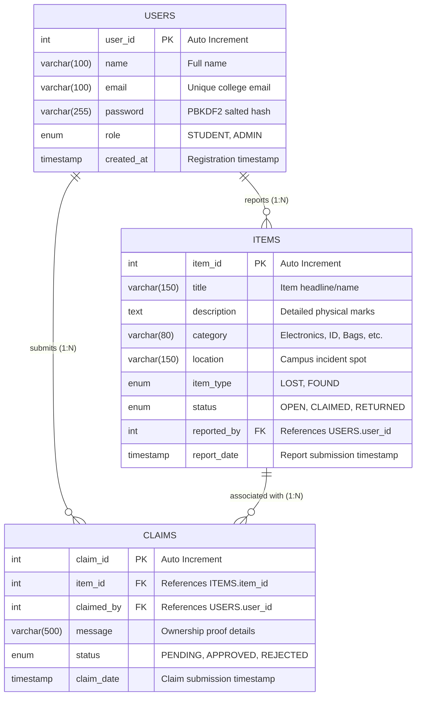

# Entity-Relationship (ER) Diagram: Smart Campus Lost and Found

This document specifies the database structure, table definitions, column specifications, constraints, and relational mappings for the MySQL database `smart_campus_db`.

---

## 1. Mermaid Entity-Relationship Diagram

---

## 2. Table Specifications & Data Dictionary

### Table 1: `users`
Stores student and administrator credentials and permissions.

| Column Name | Data Type | Nullable | Key | Default / Extra | Description |
| :--- | :--- | :---: | :---: | :--- | :--- |
| `user_id` | `INT` | NO | **PK** | `AUTO_INCREMENT` | Unique identifier for each campus user. |
| `name` | `VARCHAR(100)` | NO | | | Full name of the user. |
| `email` | `VARCHAR(100)` | NO | **UK** | | Unique college email address used for authentication. |
| `password` | `VARCHAR(255)` | NO | | | PBKDF2 hash formatted as `iterations:salt:hash`. |
| `role` | `ENUM('STUDENT','ADMIN')` | YES | | `'STUDENT'` | Security access tier determining accessible dashboards. |
| `created_at` | `TIMESTAMP` | YES | | `CURRENT_TIMESTAMP` | Account creation timestamp. |

---

### Table 2: `items`
Stores reports of items that have been either lost or found across campus.

| Column Name | Data Type | Nullable | Key | Default / Extra | Description |
| :--- | :--- | :---: | :---: | :--- | :--- |
| `item_id` | `INT` | NO | **PK** | `AUTO_INCREMENT` | Unique identifier for each reported item. |
| `title` | `VARCHAR(150)` | NO | | | Concise descriptive name of the item. |
| `description` | `TEXT` | YES | | | Detailed description, colors, condition, contents. |
| `category` | `VARCHAR(80)` | YES | | | Categorical grouping (e.g., Electronics, ID Card). |
| `location` | `VARCHAR(150)` | YES | | | Campus location where lost or found. |
| `item_type` | `ENUM('LOST','FOUND')` | NO | | | Classification of the item report. |
| `status` | `ENUM('OPEN','CLAIMED','RETURNED')` | YES | | `'OPEN'` | Current lifecycle status of the item. |
| `reported_by` | `INT` | NO | **FK** | | Foreign key referencing `users(user_id)`. |
| `report_date` | `TIMESTAMP` | YES | | `CURRENT_TIMESTAMP` | Timestamp when the item was submitted. |

---

### Table 3: `claims`
Stores ownership claims filed by students against found items.

| Column Name | Data Type | Nullable | Key | Default / Extra | Description |
| :--- | :--- | :---: | :---: | :--- | :--- |
| `claim_id` | `INT` | NO | **PK** | `AUTO_INCREMENT` | Unique claim identifier. |
| `item_id` | `INT` | NO | **FK** | | Foreign key referencing `items(item_id)`. |
| `claimed_by` | `INT` | NO | **FK** | | Foreign key referencing `users(user_id)`. |
| `message` | `VARCHAR(500)` | YES | | | Specific proof of ownership submitted by student. |
| `status` | `ENUM('PENDING','APPROVED','REJECTED')` | YES | | `'PENDING'` | Administrative review verdict. |
| `claim_date` | `TIMESTAMP` | YES | | `CURRENT_TIMESTAMP` | Timestamp when claim was submitted. |

---

## 3. Referential Integrity & Relational Constraints

1. **`items.reported_by` → `users.user_id`**:
   - `ON DELETE RESTRICT`: Prevents deleting a user account if that user has active item reports. This protects the system against orphaned item reports.
2. **`claims.item_id` → `items.item_id`**:
   - `ON DELETE CASCADE`: If an item report is permanently purged by an administrator, any associated ownership claims are cleaned up in an atomic transaction.
3. **`claims.claimed_by` → `users.user_id`**:
   - `ON DELETE RESTRICT`: Prevents deleting a student user account if they have submitted claims pending or approved in the system.
