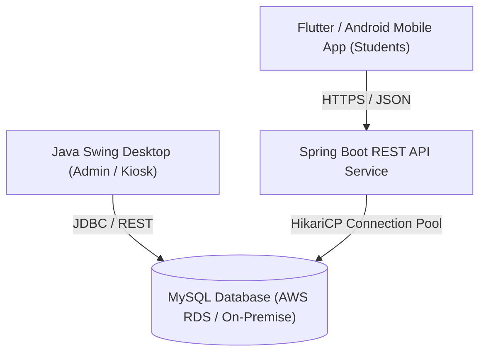

# Future Scope & System Extensions: Smart Campus Lost and Found

This document outlines architectural, algorithmic, and operational extensions proposed for subsequent versions, academic research expansions, or enterprise-scale campus deployments.

> **Development Note:**  
> Core capabilities previously listed as preliminary concepts—specifically **Photo Uploads & Preview** (Feature 2), **Deterministic Similarity Matching** (Feature 6), and the **In-App Notification Center** (Feature 7)—have now been **fully developed and integrated into the primary codebase**. The topics below represent true forward-looking extensions beyond the current 7 completed features.

---

## 1. External Messaging Channels (Email & SMS Delivery)

### Proposed Enhancement:
Complement the existing in-app notification center (`NotificationsPanel`) by sending external email alerts or SMS notifications for high-priority campus events.

### Proposed Architecture:
- **Email Channel**: Integrate the JavaMail API (`javax.mail` / Jakarta Mail) through institutional SMTP servers to dispatch official claim approval notices.
- **SMS Gateway**: Integrate with campus telecom providers or REST SMS webhooks (e.g., Twilio, AWS SNS) to notify students when valuable property (laptops, wallets) is reported found.
- **Asynchronous Dispatch Queue**: Leverage a persistent worker queue (e.g., RabbitMQ or SQLite queue) to prevent slow SMTP handshakes from affecting desktop application responsiveness.

---

## 2. Barcode & QR Code Tagging for Campus Property

### Proposed Enhancement:
Enable students to pre-register personal belongings (e.g., scientific calculators, lab equipment, bikes) and generate a tamper-evident QR code sticker to affix to their possessions.

### Workflow:
1. Student registers an asset's serial number and receives a generated QR code image (using the ZXing Java library).
2. The student prints and affixes the QR sticker to their device.
3. If recovered by campus security, scanning the QR code immediately retrieves the owner's encrypted ID without exposing their phone number or address publicly.

---

## 3. Interactive Spatial Campus Map (Geo-Tagging)

### Proposed Enhancement:
Replace text-based campus location dropdowns with an interactive visual map of university grounds and buildings.

### Technical Implementation:
- A custom Swing component (`JPanel`) rendering a high-resolution vector map of the campus grounds, buildings, and athletic facilities.
- Interactive clickable pins marking hotspots where items are frequently lost or found (e.g., Library, Cafeteria, Sports Complex, Engineering Blocks).
- Floorplan integration showing specific floor and room layouts for complex facilities.

---

## 4. Multi-Campus & Multi-Tenant Partitioning

### Proposed Enhancement:
Expand database architecture to support multi-campus university systems where departments, satellite campuses, or affiliated colleges operate within distinct organizational silos while allowing centralized security administration.

### Proposed Architecture:
- Add a `campus_id` or `institution_id` tenant key across all database tables.
- Role-based multi-tenancy allowing campus security teams to manage their respective campus inventory while granting university-wide search permissions for lost student identification cards.

---

## 5. Cloud REST API & Mobile Companion App

### Proposed Enhancement:
Complement desktop kiosks by exposing a secure RESTful API backend for mobile student access.

- **Framework**: Spring Boot REST API with JWT (JSON Web Token) authentication and Spring Security.
- **Mobile Client**: Flutter or Native Android cross-platform application for on-the-go student access.
- **Cloud Database**: Migration to Amazon RDS or institutional cloud infrastructure with automatic read replicas.
