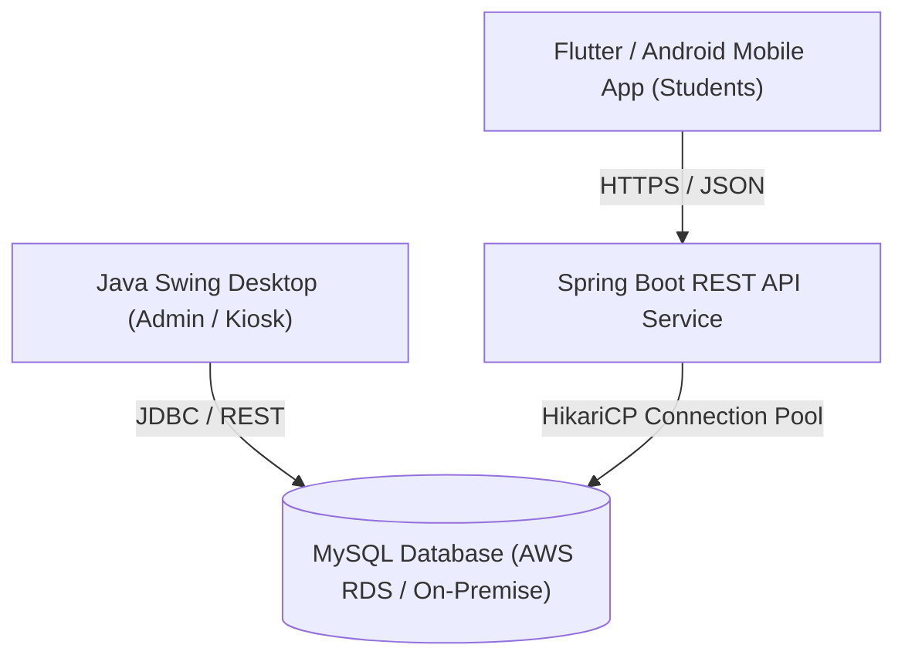

# Future Scope & System Extensions: Smart Campus Lost and Found

This document outlines architectural, algorithmic, and functional extensions proposed for future development phases, academic expansions, or enterprise-scale campus deployments.

---

## 1. High-Resolution Image Capture & Media Storage

### Proposed Enhancement:
Allow students reporting found items to upload photographs (e.g., photo of a found water bottle, jacket, or backpack) to assist in quick visual identification.

### Technical Implementation:
- **Client Side**: `JFileChooser` image picker with client-side image compression (`javax.imageio.ImageIO`) to restrict resolution to a standard size (e.g., $800 \times 600$ px).
- **Storage Strategy**: Store image binaries in a secure dedicated file directory (`resources/uploads/items/`) and store only the relative file path in the MySQL database (rather than storing heavy BLOBs directly in table rows).
- **Privacy Controls**: Automatically mask sensitive personal data (e.g., partial blurring of student identification cards or phone numbers).

---

## 2. Automated AI / NLP Similarity Matching

### Proposed Enhancement:
When a student reports a `LOST` item, the system automatically analyzes active `FOUND` items and calculates a match probability score, instantly suggesting potential matches.

### Technical Implementation:
- **String Distance Algorithms**:
  - Implement **Levenshtein Distance** or **Jaro-Winkler Similarity** on titles and categories.
  - Implement TF-IDF (Term Frequency-Inverse Document Frequency) or Cosine Similarity on detailed descriptions.
- **Match Notification**:
  If a similarity score exceeds a threshold (e.g., $> 75\%$), display an alert:
  *"A similar item was reported found at the Central Library. Click here to inspect."*

---

## 3. Real-Time Campus Notifications (Email / SMS)

### Proposed Enhancement:
Automated notification triggers sent to students when their reports receive updates or when an ownership claim is adjudicated.

### Notification Triggers:
1. **Claim Decision Notice**: Email sent to claimant when admin marks claim as `APPROVED` or `REJECTED`.
2. **Item Match Alert**: Automatic alert sent to student who reported a lost item when a matching found item is logged.
3. **Weekly Digest**: Automated summary of open found items on campus sent to the student body.

### Technical Implementation:
- JavaMail API (`javax.mail`) integrating with the college SMTP relay server.
- Asynchronous notification queue executed via background executor threads to avoid impacting GUI responsiveness.

---

## 4. Barcode / QR Code Tagging for Campus Property

### Proposed Enhancement:
Enable students to register personal belongings (e.g., laptops, bicycles, scientific calculators) at the beginning of the semester and generate a unique QR code sticker.

### Workflow:
1. Student registers asset serial number and receives a downloadable QR code image (using the ZXing Java library).
2. The student affixes the QR sticker to their device.
3. If found by campus security, scanning the QR code immediately retrieves the owner's encrypted ID without exposing their phone number or address to the public.

---

## 5. Interactive Campus Map (Spatial Geo-Tagging)

### Proposed Enhancement:
Replace text-based campus location dropdowns with an interactive visual map of the college campus.

### Technical Implementation:
- A custom Swing component (`JPanel`) rendering a high-resolution vector map of the campus grounds, buildings, and athletic facilities.
- Interactive clickable pins marking hotspots where items are frequently lost or found (e.g., Library, Cafeteria, Sports Complex, Engineering Block).

---

## 6. Cloud REST API & Mobile Companion App

### Proposed Enhancement:
Expand the application beyond desktop kiosks by exposing a secure RESTful API backend.

- **Framework**: Spring Boot REST API with JWT (JSON Web Token) authentication.
- **Mobile Client**: Flutter or Native Android cross-platform application for on-the-go student access.
- **Cloud Database**: Migration to Amazon RDS or institutional cloud infrastructure.
