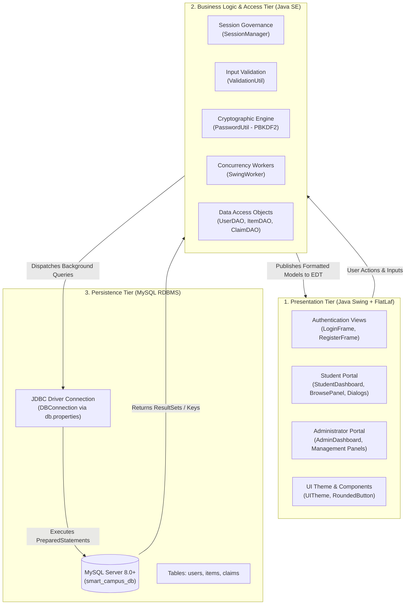
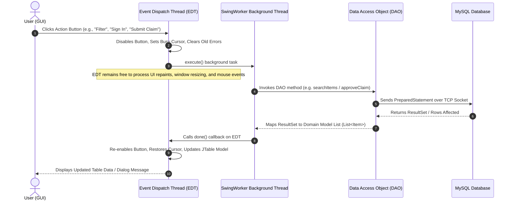
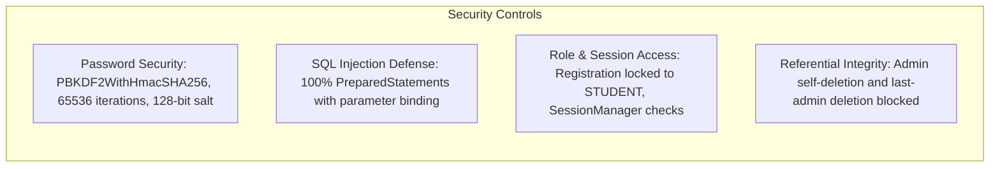
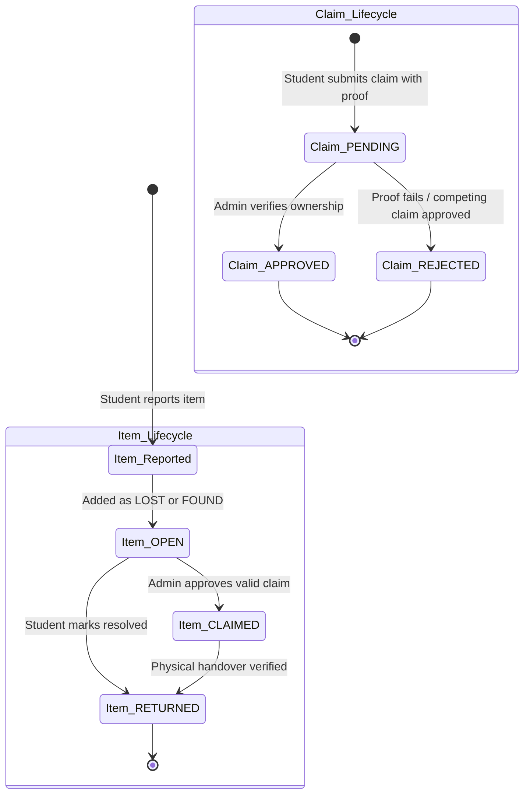

# System Architecture: Smart Campus Lost and Found

This document details the multi-tiered system architecture, data flow, concurrency model, security enforcement, and state transition lifecycles of the **Smart Campus Lost and Found System**.

---

## 1. High-Level Multi-Tier Layered Architecture

The application is structured into three cleanly decoupled layers following the **Model-View-DAO** architecture pattern:

---

## 2. Concurrency Model: Non-Blocking UI Execution

To prevent the Java Swing GUI from freezing during network socket connections and MySQL queries, the application enforces the **SwingWorker Concurrency Pattern**:

---

## 3. Security Architecture & Threat Mitigations

---

## 4. Item and Claim Lifecycle State Transitions

The lifecycle of reported items and submitted claims is synchronized through database state transitions:

- When a claim is set to `APPROVED`, the associated item is atomically transitioned to `CLAIMED`.
- Competing claims remaining in `PENDING` for that item are automatically set to `REJECTED`.
