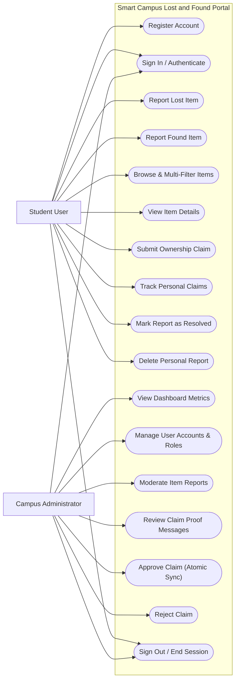

# Use Case Diagram: Smart Campus Lost and Found

This document specifies the primary actors, boundaries, and use case interactions for the **Smart Campus Lost and Found System**.

---

## 1. Actors and Roles

1. **Student (`STUDENT`)**:
   - Authenticated campus student.
   - Reports lost belongings or items found across campus.
   - Searches and filters reported items.
   - Submits ownership claims with descriptive proof.
   - Manages personal item reports and tracks claim review decisions.
2. **Administrator (`ADMIN`)**:
   - Campus security or authority personnel.
   - Oversees the system-wide item catalog and moderation.
   - Reviews and adjudicates student ownership claims.
   - Manages user accounts and roles with security safeguards.
   - Monitors live campus KPI metrics.

---

## 2. Mermaid Use Case Diagram

---

## 3. Use Case Descriptions

### UC-1: Register Account
- **Actor**: Student
- **Preconditions**: User has a valid college email not previously registered.
- **Trigger**: Clicks "Register here" on `LoginFrame`.
- **Workflow**:
  1. Student enters full name, email, password, and confirmation.
  2. System validates format and minimum length.
  3. System checks for duplicate email.
  4. System hashes password with PBKDF2 + random salt and assigns `STUDENT` role.
  5. Account is saved in the `users` table.

### UC-5: Browse & Multi-Filter Items
- **Actor**: Student & Admin
- **Preconditions**: User is logged in.
- **Workflow**:
  1. User enters keywords or selects Category, Type (`LOST`/`FOUND`), and Status (`OPEN`/`CLAIMED`/`RETURNED`).
  2. System executes dynamic parameterized query off the UI thread via `SwingWorker`.
  3. Results are rendered in a styled table with color-coded status badges.

### UC-7: Submit Ownership Claim
- **Actor**: Student
- **Preconditions**: Item is `FOUND`, status is `OPEN`, and not reported by the same student.
- **Workflow**:
  1. Student selects eligible item and clicks "Claim Found Item".
  2. Student enters unique identifying features (lock screen, serial number, contents).
  3. System verifies no prior claim exists by this student for this item.
  4. Claim is persisted with `PENDING` status.

### UC-15: Approve Claim (Atomic Adjudication)
- **Actor**: Administrator
- **Preconditions**: Administrator is logged into `AdminDashboard`.
- **Workflow**:
  1. Admin inspects claimant contact details and proof message.
  2. Admin clicks "Approve Claim".
  3. In a single database transaction (`setAutoCommit(false)`):
     - Claim status becomes `APPROVED`.
     - Target item status synchronizes to `CLAIMED`.
     - Competing pending claims on the same item are automatically set to `REJECTED`.
  4. Transaction is committed. Conflicting approvals are blocked.
